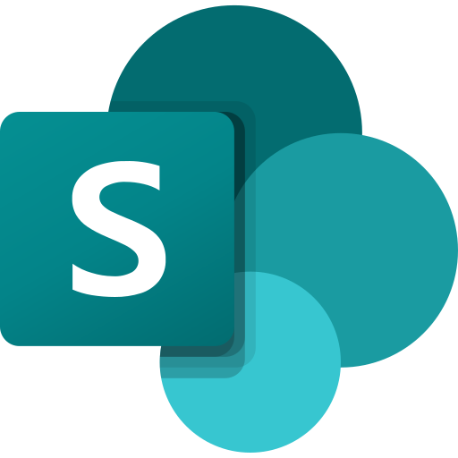

# Hi, I'm Enrique Higa 👋

### 🏭 Industrial Engineer | Industry 4.0 | Digital Solutions

### 👨‍💻 About Me

I'm an Industrial Engineer with an MBI in Automotive Industry 4.0, passionate about digital transformation and process improvement.

My journey into software development began with Microsoft Power Platform, and I'm now expanding my skills in **Go and Vue.js** to build innovative solutions for manufacturing.

## 🛠️ Tech Stack

### Microsoft Technologies — Experience

  &nbsp;&nbsp;&nbsp;&nbsp;
  &nbsp;&nbsp;&nbsp;&nbsp;
  &nbsp;&nbsp;&nbsp;&nbsp;
  &nbsp;&nbsp;&nbsp;&nbsp;
  

### Development — Currently Learning

  &nbsp;&nbsp;&nbsp;&nbsp;
  &nbsp;&nbsp;&nbsp;&nbsp;
  &nbsp;&nbsp;&nbsp;&nbsp;
  &nbsp;&nbsp;&nbsp;&nbsp;
  &nbsp;&nbsp;&nbsp;&nbsp;
  
